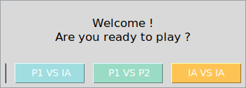
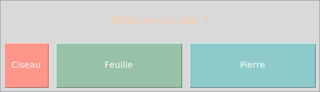
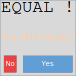
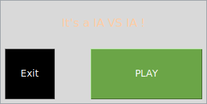

# Rock Paper Scissors (Pierre Feuille Ciseaux)

[](https://github.com/LaCobble/Pierre_Feuille_Ciseaux/actions/workflows/ci.yml)


[](LICENSE)

Rock paper scissors with a Tkinter interface and three modes (player vs AI, player vs player, AI vs AI), built under a two-hour time limit.

<p align="center">
  
</p>

## What it does

The main menu offers three modes:

1. **P1 vs IA**: you play against the computer, which picks a random move.
2. **P1 vs P2**: two players take turns on the same computer.
3. **IA vs IA**: two random players face each other.

After each round the game shows the result (win, draw or loss) and asks whether you want to play again. Known issue: in player vs AI mode some win/loss outcomes are inverted (for example rock against paper is shown as a win). The move buttons use the French names: *Pierre* (rock), *Feuille* (paper), *Ciseau* (scissors).

## Screenshots

Captured on Linux (Xvfb) by running the real program and pressing its buttons; window titles are not shown. The fixed window sizes come from the original code.

<table>
  <tr>
    <td width="50%" align="center"></td>
    <td width="50%" align="center"></td>
  </tr>
  <tr>
    <td align="center"><sub>Main menu: the three modes</sub></td>
    <td align="center"><sub>Player vs AI: pick <i>Pierre</i>, <i>Feuille</i> or <i>Ciseau</i></sub></td>
  </tr>
  <tr>
    <td align="center"></td>
    <td align="center"></td>
  </tr>
  <tr>
    <td align="center"><sub>Round result and replay prompt</sub></td>
    <td align="center"><sub>AI vs AI: press <b>PLAY</b> to watch a round</sub></td>
  </tr>
</table>

## Getting started

### Prerequisites

- Python 3.8 or newer with Tkinter. Tkinter ships with the python.org installers for Windows and macOS; on Debian/Ubuntu install it with `sudo apt install python3-tk`. No other package is needed.

### Run

```bash
git clone https://github.com/LaCobble/Pierre_Feuille_Ciseaux.git
cd Pierre_Feuille_Ciseaux
python PFC.py
```

## Project structure

```text
.
├── PFC.py      # the whole game: main menu, the three modes, result windows
└── README.md
```

## What this project demonstrates

- Building a multi-window desktop GUI with Tkinter (menus, buttons, pop-ups).
- Encoding game rules and a random computer player.
- Delivering a complete, playable program under a strict two-hour constraint.

## Context

A personal challenge from 2021: build a complete game with a graphical interface in under two hours. The code is kept as it was written, as a portfolio piece; only the repository around it (documentation, CI) has been tidied up.

## Contributing

Issues and small pull requests are welcome: see [CONTRIBUTING.md](CONTRIBUTING.md) and the [Code of Conduct](CODE_OF_CONDUCT.md).

## License

[MIT](LICENSE) © LaCobble
